<h1 align="center">Hey, I'm Ohnobro 👋</h1>

<i>গ্রাম থেকে কোড — সমস্যা দেখলেই টুল বানাই 🛠️</i>

  

  
  &nbsp;
  

---

## 🚀 About Me

I build **web tools that solve real problems** — Gmail productivity tools, government-form photo resizers, browser games, all client-side and privacy-first. By day I run a village variety shop; by night I'm deep in a 12-week cybersecurity mentorship and growing my f-commerce brand **Shokhbox**.

- 🔭 **Currently building:** advanced zero-backend web tools (HTML · CSS · JS · Python)
- 🌱 **Learning:** Cybersecurity — Linux · Networking · Web App Security
- 💬 Ask me about: web tools, f-commerce, cybersecurity basics
- 🛍️ **Founder:** Shokhbox — f-commerce brand
- 🎯 **2026 goal:** ship 10 public tools
- ⚡ **Fun fact:** my toughest beta testers are 8-year-olds at the primary school in front of my shop

---

## 🛠️ Tech Stack

---

## 📊 GitHub Stats

---

## 🌟 Featured Projects

  
  

> 🛠️ More tools are on the way — photo resizers, arcade games and productivity apps, all shipping here soon.

---

## 🐍 Watch My Contributions Get Eaten

<picture>
<source media="(prefers-color-scheme: dark)" srcset="https://raw.githubusercontent.com/ohnobro398-png/ohnobro398-png/output/github-contribution-grid-snake-dark.svg" />
<source media="(prefers-color-scheme: light)" srcset="https://raw.githubusercontent.com/ohnobro398-png/ohnobro398-png/output/github-contribution-grid-snake.svg" />

</picture>

---

## 🤝 Let's Connect

  

---

<i>"Build in public. Ship fast. Stay curious."</i> ⚡

© 2026 Ohnobro

