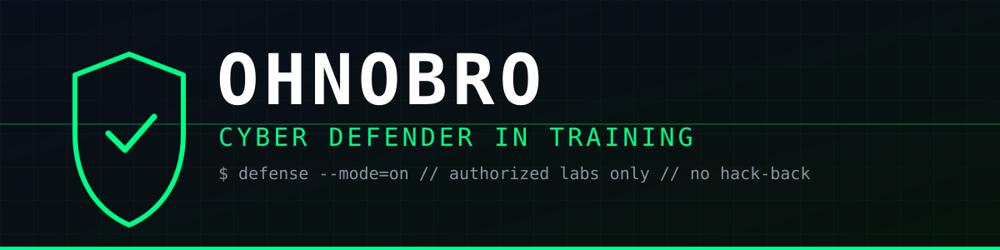

<h1 align="center">🛡️ Ohnobro — Cyber Defender</h1>
<p align="center"><i>Defense first. No target without authorization.</i></p>

<p align="center">
  <a href="https://github.com/ohnobro398-png">
    
  </a>
</p>

<p align="center">
  
  &nbsp;
  <a href="https://github.com/ohnobro398-png?tab=followers"></a>
  &nbsp;
  
</p>

```console
$ whoami
ohnobro // cyber-defender
$ mission --mode defensive-only
✔ authorized labs only  ·  ✔ no hack-back  ·  ✔ own code first
```

---

## 🛡️ Defense Protocol

I learn security the defensive way: **protect first, understand attacks only to stop them.** Every lab runs on my own systems or authorized practice targets — never on someone else's site.

- 🔭 **Currently building:** advanced zero-backend web tools (HTML · CSS · JS · Python)
- 🌱 **Advancing:** 12-week cybersecurity mentorship — Linux · Networking · Web App Security
- 🧪 **Lab:** Kali Linux on my own VM — terminal, defensive missions, authorized labs only
- 💬 Ask me about: web tools, cybersecurity, f-commerce
- 🛍️ **Founder:** Shokhbox — f-commerce brand
- 🎯 **2026 goal:** ship 10 public tools
- ⚡ **Fun fact:** I test every tool on my own setup before it reaches anyone else.

---

## 🛰️ Operator Card

| | |
|---|---|
| **Callsign** | OHNOBRO |
| **Mode** | DEFENSIVE ONLY |
| **Scope** | My own systems + authorized labs |
| **Doctrine** | Protect first, prove it second |
| **Status** | ACTIVE — Defending own systems + authorized labs |

---

## 📜 Mission Log

- **2026-10** — 12-week defensive cybersecurity mentorship begins
- **2026-10** — Quantum Shield site goes live (frozen since, defensive watch only)
- **2026-10** — Profile + first public tools ship
- **2026-11** — Profile goes full cyber-defender

---

## ⚠️ Rules of Engagement

| ✅ I do | ❌ I never do |
|---|---|
| Defend my own sites and apps | Scan or probe sites I don't own |
| Practice in Juice Shop, WebGoat, CTFs | Hack back, even if attacked |
| Harden, patch, and re-test my own code | Bypass paid licensing or protections |

---

## 🧰 Arsenal

<p>


</p>

### 💻 Languages
<p>


</p>

### 🛠️ Platforms & Craft
<p>


</p>

---

## 🛠️ What I Build

| 🛡️ Security Path | 🛠️ Web Tools | 🛍️ F-Commerce |
|---|---|---|
| 12-week defensive mentorship: Linux, networking, web app security — own labs only | Zero-backend, privacy-first tools that run entirely in the browser — resizers, alias generators, games | Founder of Shokhbox — product sourcing, Bangla copywriting, promo videos, page growth |

My public skill collection lives in **[quantum-skills](https://github.com/ohnobro398-png/quantum-skills)** — agent teams and tools I actually use.

Also shipping: Android apps in Flutter, AI skill packs, and short-form video systems.

---

## 📊 GitHub Stats

<p align="center">


</p>
<p align="center">

</p>

---

## 📈 Activity Graph

<p align="center">

</p>

---

## 🌟 Featured Projects

<p align="center">
  <a href="https://github.com/ohnobro398-png/Patchbysk">
    
  </a>
  <a href="https://github.com/ohnobro398-png/Quantum-tic-tac-toe-">
    
  </a>
</p>

> 🛠️ More tools are on the way — photo resizers, arcade games and productivity apps, all shipping here soon.

---

## 🐍 Watch My Contributions Get Eaten


---

## 🤝 Let's Connect

<p>
  <a href="https://www.facebook.com/shokhbox"></a>
</p>

---

*"Build in public. Ship fast. Stay curious — and defend what you build."* ⚡

© 2026 Ohnobro
